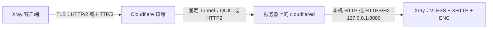

# Argosbx Enhanced

[](https://github.com/mutsuki14/argosbx-enhanced/actions/workflows/test.yml)

基于 [yonggekkk/argosbx](https://github.com/yonggekkk/argosbx) 的增强版，使用 Xray、Sing-box 和 cloudflared 部署代理服务，重点支持 **VLESS + XHTTP + 固定 Argo + TLS + VLESS Encryption（ENC）**。

在基础链路上，可配置 **HTTP/3、QUIC 隧道、XMUX、上下行分离和 FinalMask TLS 分片**。提供 Linux 安装脚本、网页命令生成器和可自行构建的 Node 容器。

传输模式支持默认的 `packet-up`，以及通过 **HTTPS + HTTP/2 回源**实现的实验性 `stream-up` / `stream-one`。后两种模式需要同步调整 Cloudflare 的回源设置，详见[流式模式](#流式模式实验性)。

在终端直接运行 **`agsbx` 打开管理菜单**。首次安装有向导，日常可用 `status` 查看状态、`mode` 切换方案、`doctor` 排查连接、`export` 导出客户端，原有环境变量命令继续可用。

**新增菜单 10：XHTTP 一键搭建与增强。** 可选择 `VLESS-XHTTP-REALITY-ENC`、`VLESS-XHTTP-固定 Argo-TLS-ENC`，或一次部署两种节点；分别调整 XMUX、FinalMask、传输模式、填充和分包参数。已有节点进入该选项可直接调整增强设置。

> **本项目的所有 Argo 入口只支持固定隧道。** 必须同时提供固定域名和 Tunnel Token；缺失时停止部署，不创建或恢复 `trycloudflare.com` 随机隧道。VMess / VLESS WebSocket 的 Argo 入口同样遵守这一规则。

[快速部署](#快速部署) · [XHTTP 专区](#xhttp-一键搭建与增强) · [客户端导入](#客户端导入) · [增强组合](#增强组合) · [管理与更新](#管理与更新) · [参数参考](#参数参考) · [Docker 部署](#docker-部署) · [常见问题](#常见问题)

## 功能与适用入口

| 入口 | 用途 | XHTTP 增强组合 |
| --- | --- | --- |
| [argosbx.sh](argosbx.sh) | Linux 主机安装、重配、更新和管理 | 支持 |
| [index.html](index.html) | 在网页中选择参数，生成部署命令 | 支持，包含参数冲突检查 |
| [Node 容器](container/nodejs) | 在容器中运行服务并提供配置下载 | 支持，需从本仓库构建 |
| [SAP 旧版流程](SAP.md) | 保留的上游批量部署方式 | 使用上游镜像，不包含本项目增强组合 |

主脚本还保留原有协议入口，可按需与增强节点一起部署：

| 参数 | 协议 |
| --- | --- |
| `vxpt` | VLESS XHTTP ENC；配合 `argo=vxpt` 启用本文的固定隧道方案 |
| `vlpt` / `xhpt` | VLESS TCP REALITY / VLESS XHTTP REALITY ENC |
| `vwpt` / `vmpt` | VLESS WebSocket ENC / VMess WebSocket |
| `xupt` / `xcpt` | VLESS XHTTP TLS H3 / H2 与 H3 |
| `hypt` / `tupt` | Hysteria2 / TUIC |
| `anpt` / `arpt` | AnyTLS / AnyTLS REALITY |
| `sspt` / `sopt` / `nvpt` | Shadowsocks 2022 / SOCKS5 / NaiveProxy |

这些参数指定各自的监听端口。`xhttp_*` 增强参数用于 **`vxpt` + `argo=vxpt`**；**`xhpt` REALITY 节点使用独立的 `reality_*` 同名参数**。其他协议的选项、WARP 出站等可通过网页生成器配置。

## 链路结构



- **TLS** 保护客户端至 Cloudflare 的连接，证书由该 HTTPS 入口提供。
- **固定 Tunnel** 连接 Cloudflare 与服务器上的 cloudflared，使用独立的传输协议。
- **VLESS ENC** 提供客户端至 Xray 的端到端加密，TLS 在 Cloudflare 终止不会移除这一层。
- Xray 的增强入站仅监听 `127.0.0.1`，无需向公网开放。`packet-up` 默认使用 HTTP 回源；流式模式自动生成本机证书，改用 HTTPS / H2 回源。

客户端使用 H3 与 cloudflared 使用 QUIC 是两个独立设置。设置其中一个，不会自动改变另一个。

## 快速部署

### 1. 准备环境

- 一台 Linux `x86_64` 或 `aarch64/arm64` 主机，能够下载 GitHub 上的脚本和内核。
- Bash、curl、OpenSSL，以及用于配置生成的 Python 3。root 安装会尝试通过系统包管理器补齐依赖；非 root 环境请预先安装。
- 一个可以配置 Cloudflare Tunnel 公开主机名的域名。
- 支持 XHTTP 和 VLESS ENC 的 Xray 客户端；使用 FinalMask 时还需要对应的内核支持。本项目以 **Xray v26.11.9** 验证这些功能。

新安装的 Xray 固定使用官方 **v26.11.9**，下载时验证 SHA-256。脚本不是面向 macOS 或 Windows 主机的原生安装器。

### 2. 配置固定隧道

在 Cloudflare 创建一个通过 Token 运行的**固定 Cloudflare Tunnel**，取得 Tunnel Token，并添加公开主机名：

| 配置项 | 示例 |
| --- | --- |
| 公开主机名 | `up.example.com` |
| 服务类型 | `HTTP` |
| 服务地址 | `127.0.0.1:8080` |

域名必须实际路由到这个隧道，并具有有效的 Cloudflare 边缘证书。cloudflared 与 Xray 需要运行在同一主机或同一网络命名空间中。

`agn` 只填写域名，不带 `https://`、端口或路径；`agk` 只填写 **Token 本身**，不要粘贴整条 cloudflared 安装命令。

### 3. 运行安装命令

在 Linux 主机的交互终端中运行，即可打开菜单，选择「首次安装向导」：

```bash
bash <(curl -fLsS https://raw.githubusercontent.com/mutsuki14/argosbx-enhanced/main/argosbx.sh)
```

向导依次询问固定域名、Token、本机端口和传输方案。Token 输入不显示；端口默认 `8080`、方案默认 H2 / `packet-up`。确认摘要后开始安装。向导针对首次安装；已有节点请使用下方的 `mode` 或 `upgrade`，不必重建所有协议。

自动部署或习惯直接传参时，替换以下域名和 Token 执行：

```bash
vxpt=8080 argo=vxpt agn=up.example.com agk='YOUR_TUNNEL_TOKEN' \
  bash <(curl -fLsS https://raw.githubusercontent.com/mutsuki14/argosbx-enhanced/main/argosbx.sh)
```

`vxpt=8080` 必须与隧道服务地址中的端口一致。首次安装自动生成 UUID、VLESS ENC 密钥和随机 XHTTP 路径。默认使用客户端 **H2**、隧道 **QUIC**、`packet-up` 模式，并启用 XMUX 默认参数。

安装完成后运行 `agsbx list` 查看节点。若当前终端尚未识别 `agsbx`，重新连接终端，或执行：

```bash
bash "$HOME/bin/agsbx" list
```

连接器启动只代表进程已启动。请检查 Cloudflare 中的隧道状态，再导入客户端实际测试连接。

无交互终端且未提供参数时，脚本只显示帮助，不会等待输入或开始安装。

## XHTTP 一键搭建与增强

在 `agsbx` 菜单选择 **10**，或直接运行：

```bash
# 首次使用，可直接启动专区
bash <(curl -fLsS https://raw.githubusercontent.com/mutsuki14/argosbx-enhanced/main/argosbx.sh) xhttp

# 已安装管理脚本
agsbx xhttp
```

首次安装依次选择 **双节点 / 仅 REALITY / 仅固定 Argo**，填写必要参数并确认摘要。双节点默认 REALITY 公网 TCP 端口 `443`、Argo 回环端口 `8080`，两端口不能相同。REALITY 需填写服务器公网 IP 或域名、目标站域名；目标站须在服务器侧可达并支持 TLS 1.3/H2。Argo 的 Token 使用隐藏输入，仍只支持固定隧道。

| 设置 | 可选内容 |
| --- | --- |
| 传输模式 | `packet-up`、`stream-up`、`stream-one`；Argo 分包模式另可选择 H3 |
| XMUX | 均衡、低复用、固定 4 连接，或逐项自定义并发数、复用次数、请求上限、生命周期和保活 |
| FinalMask | 开关 TLS ClientHello 分片；可调整分片长度、间隔和最大数量 |
| 地址与路径 | 自定义连接地址、保留或重新生成随机 XHTTP 路径 |
| HTTP / 分包参数 | 填充字节、`packet-up` 每次 POST 字节上限和发送间隔 |
| Argo 下行分离 | 下行地址、端口、Host、SNI、H2/H3 与独立的 TLS 分片开关 |
| 隧道连接协议 | 固定 Argo 可选 QUIC、HTTP2 或自动 |

两种节点的参数、随机路径和导出文件独立保存。REALITY 默认 **H2 / stream-one**，Argo 默认 **H2 / packet-up**；REALITY 不支持 H3，此处的 REALITY 直连预设也不配置下行分离。Argo 的 `stream-one` 不能使用下行分离；流式 Argo 仍需按下一节配置 HTTPS/H2 回源。

XMUX 预设控制复用行为，不代表带宽保证；增加连接数可能增加资源消耗。FinalMask 用于分片，可能增加延迟，并非加速开关。相关字段依据 [XHTTP 官方说明](https://github.com/XTLS/Xray-core/discussions/4113)与 [FinalMask 文档](https://xtls.github.io/config/transports/finalmask.html)，并经过本项目的真实内核测试。

已有节点可分别调整、预览和导出：

```bash
agsbx tune --profile reality --dry-run
agsbx tune --profile reality
agsbx tune --profile argo
agsbx mode stream-up --profile reality
agsbx export --profile reality ~/reality-client.json
agsbx export --profile argo ~/argo-client.json
agsbx doctor --profile reality
```

只安装一种增强节点时，管理命令自动选择该节点；双节点省略 `--profile` 时选择 Argo。旧版 `xhpt` 节点可以通过 `tune --profile reality` 迁移至独立增强配置。应用前校验并备份，失败恢复；修改后重新导入客户端。新建协议组合仅用于首次安装，已有安装的专区用于调整现有节点；增加协议仍使用完整参数命令加 `rep`，须带上要保留的所有协议。

自动部署双节点示例：

```bash
xhpt=443 reym=www.microsoft.com reality_address=你的服务器IP \
reality_mode=stream-one reality_finalmask=tls-fragment \
reality_xmux='{"maxConcurrency":"4-8","cMaxReuseTimes":"64-128"}' \
vxpt=8080 argo=vxpt agn=up.example.com agk='你的固定隧道Token' \
xhttp_mode=packet-up xhttp_alpn=h2 \
bash <(curl -fLsS https://raw.githubusercontent.com/mutsuki14/argosbx-enhanced/main/argosbx.sh)
```

仅安装 REALITY 时保留 `xhpt`、`reym` 和 `reality_*` 即可，不需要 Argo 域名或 Token。脚本不会自动修改云平台安全组：放行 REALITY 的公网 TCP 端口；Argo 的本机回环端口无需开放。

## 流式模式（实验性）

| 模式 | 客户端连接 | 本机回源 | 上下行分离 |
| --- | --- | --- | --- |
| `packet-up` | H2 或 H3 | HTTP | 支持 |
| `stream-up` | H2 | HTTPS + H2 | 支持 |
| `stream-one` | H2 | HTTPS + H2 | 不支持；同一请求双向传输 |

首次部署 `stream-up`：

```bash
xhttp_mode=stream-up xhttp_alpn=h2 \
  vxpt=8080 argo=vxpt agn=up.example.com agk='YOUR_TUNNEL_TOKEN' \
  bash <(curl -fLsS https://raw.githubusercontent.com/mutsuki14/argosbx-enhanced/main/argosbx.sh)
```

使用 `stream-one` 时，将 `xhttp_mode` 改为 `stream-one`，且不配置下行分离。已有增强 XHTTP 安装可直接用 `agsbx mode stream-up`；切到单请求模式用 `agsbx mode stream-one --disable-split`。这两个命令自动使用 H2，并保留其他协议与现有端口、UUID、密钥和路径。

脚本自动生成并保存 `~/agsbx/xhttp-origin.crt` 和 `~/agsbx/xhttp-origin.key`。然后在**固定隧道的公开主机名**上应用以下设置：

| Cloudflare 设置 | 值 |
| --- | --- |
| Service | **HTTPS**，`127.0.0.1:8080`（端口与 `vxpt` 一致） |
| HTTP/2 to origin / `http2Origin` | **开启** |
| Origin Server Name | `localhost` |
| Match SNI to Host | **关闭** |
| CA Pool | 部署输出的 `xhttp-origin.crt` **绝对路径**；root / 本项目容器通常为 `/root/agsbx/xhttp-origin.crt` |
| Disable TLS certificate verification / `noTLSVerify` | **关闭 / false**，保留证书校验 |

还需在 Cloudflare **域名的 Network 设置**中开启 gRPC。`agsbx list` 会导出 `~/agsbx/xhttp-tunnel-ingress.json`，其中包含这条路由的实际服务地址和回源参数，方便核对。**该文件不会自动修改 Cloudflare 配置，也不是用于覆盖其他隧道路由的完整配置。**

流式客户端保留 gRPC 请求头；`stream-one` 的服务端关闭 SSE 响应头，以减少同一请求双向传输时的兼容问题。XMUX 与 H2 FinalMask 可继续使用。固定 Argo 的流式配置暂不接受客户端 H3。

Cloudflare 官方目前仍将公开主机名上的 gRPC 列为未支持场景，因此这里提供的是经过本地真实传输验证的**实验性配置**，不能保证每条 Cloudflare 线路都可用。[Cloudflare 限制说明](https://developers.cloudflare.com/network/grpc-connections/)、[HTTP/2 回源参数](https://developers.cloudflare.com/cloudflare-one/networks/connectors/cloudflare-tunnel/configure-tunnels/origin-parameters/#http2origin)。

回退时运行 `agsbx mode packet-up --alpn h2`，并将 Cloudflare Service 改回 **HTTP**、关闭 HTTP/2 to origin。修改脚本模式后，远程回源设置必须同步修改。

## 客户端导入

| 文件 | 内容与使用方式 |
| --- | --- |
| `~/agsbx/xhttp-client.json` | 完整 Xray 客户端配置，推荐导入方式；包含 `127.0.0.1:10808` SOCKS 入口 |
| `~/agsbx/xhttp-uri.txt` | VLESS 分享链接，需要客户端支持 XHTTP、ENC 及 URI 中的 `extra` |
| `~/agsbx/jh.txt` | 普通聚合订阅；可完整表达的增强节点链接会加入其中 |
| `~/agsbx/xhttp-options.json` | 保存高级参数和随机路径，供后续重配及重新导出使用 |
| `~/agsbx/xhttp-tunnel-ingress.json` | 当前固定隧道路由需要应用的回源设置 |

运行 `agsbx list` 可重新导出配置。文件包含节点凭据，应作为私有配置保存。

也可运行 `agsbx export ~/xhttp-client.json` 直接导出到指定位置；省略路径时写入当前目录的 `xhttp-client.json`。输出文件权限为 `600`，指定目标文件存在时会覆盖。`agsbx export --uri` 仅显示分享链接；不会把缺少 FinalMask 设置的链接当作完整配置。

REALITY 对应 `~/agsbx/xhttp-reality-client.json`、`xhttp-reality-uri.txt` 和 `xhttp-reality-options.json`，使用 `agsbx export --profile reality` 导出。启用 FinalMask 时，该节点同样仅提供完整 JSON。

**只要任一方向启用 FinalMask，就必须使用完整 JSON。** 此时 `xhttp-uri.txt` 留空，避免生成缺少分片设置的链接。支持普通 VLESS 链接，不代表支持这些高级字段。

Clash / Mihomo / Sing-box 的原有订阅继续服务于兼容的其他协议；本项目不会把增强 Xray JSON 自动转换为这些客户端的等价节点。使用支持自定义 Xray JSON 的客户端，并确认其内核版本。

## 增强组合

以下命令用于首次部署，域名和 Token 均需替换。**修改现有安装时，在完整命令末尾添加 `rep`，并带上所有需要保留的协议参数**，详见[管理与更新](#管理与更新)。

### HTTP/3 + QUIC 隧道

```bash
xhttp_alpn=h3 agproto=quic \
  vxpt=8080 argo=vxpt agn=up.example.com agk='YOUR_TUNNEL_TOKEN' \
  bash <(curl -fLsS https://raw.githubusercontent.com/mutsuki14/argosbx-enhanced/main/argosbx.sh)
```

客户端至边缘使用 H3，cloudflared 至 Cloudflare 使用 QUIC。前者需要边缘支持 HTTP/3 和客户端网络允许相应 UDP；后者需要服务器能够连接 Tunnel 的 UDP 7844 端口。

如果 UDP 不通，可将客户端改为 `xhttp_alpn=h2`、隧道改为 `agproto=http2`。`agproto=auto` 允许 cloudflared 自动选择及回退；显式选择 `quic` 时脚本不会擅自改为 HTTP2。

### XMUX 连接复用调优

```bash
xhttp_xmux='{"maxConcurrency":"8-16","hMaxRequestTimes":"600-900","hMaxReusableSecs":"1800-3000"}' \
  vxpt=8080 argo=vxpt agn=up.example.com agk='YOUR_TUNNEL_TOKEN' \
  bash <(curl -fLsS https://raw.githubusercontent.com/mutsuki14/argosbx-enhanced/main/argosbx.sh)
```

默认 XMUX 参数如下；提供部分字段时，其余字段补齐为默认值：

```json
{
  "maxConcurrency": "16-32",
  "maxConnections": 0,
  "cMaxReuseTimes": 0,
  "hMaxRequestTimes": "600-900",
  "hMaxReusableSecs": "1800-3000",
  "hKeepAlivePeriod": 0
}
```

`maxConcurrency` 与 `maxConnections` 不能同时非零。只提供 `maxConnections` 时，生成器会将 `maxConcurrency` 置为 `0`。使用 XHTTP 自身的 XMUX 即可，不要再叠加客户端通用 `mux.cool`。

### 上行 Argo，下行直连或另一 CDN

```bash
xhttp_download_address=down.example.com \
  vxpt=8080 argo=vxpt agn=up.example.com agk='YOUR_TUNNEL_TOKEN' \
  bash <(curl -fLsS https://raw.githubusercontent.com/mutsuki14/argosbx-enhanced/main/argosbx.sh)
```

上行经 `up.example.com` 的固定隧道，下行经 `down.example.com`。生成器会写入独立的 `downloadSettings`，包含下行地址、TLS、Host、ALPN 和 XMUX；上下行保持同一路径。

**两个入口必须最终到达同一个 Xray 进程的同一个 XHTTP 入站。** 在另一台服务器运行相同 UUID 的节点，或将请求分散到不同 Xray 副本，都不能替代这个要求。

下行域名需要有效证书，并反向代理到同一 `127.0.0.1:8080`。以下同机 Caddy 示例适用于默认的 `packet-up`；`stream-up` 的下行代理也需改为 HTTPS / H2 回源并信任本机证书，见[详细示例](docs/xhttp-argo.md#流式分离的下行回源)。

```caddyfile
down.example.com {
    reverse_proxy 127.0.0.1:8080 {
        flush_interval -1
    }
}
```

请自行准备该域名的解析、证书和访问端口。整条 XHTTP 路径需要原样透传、允许流式响应，并避开缓存、登录验证或验证码。脚本只生成下行客户端设置，不会自动部署第二条线路。

下行连接 IP 时，另外指定证书域名，例如 `xhttp_download_servername=down.example.com`；连接地址、HTTP Host 与证书名称可分别设置，证书校验始终开启。

### FinalMask TLS 分片

```bash
xhttp_alpn=h2 xhttp_finalmask=tls-fragment \
  vxpt=8080 argo=vxpt agn=up.example.com agk='YOUR_TUNNEL_TOKEN' \
  bash <(curl -fLsS https://raw.githubusercontent.com/mutsuki14/argosbx-enhanced/main/argosbx.sh)
```

本项目的 FinalMask 支持范围是 **TCP 上的 TLS ClientHello 分片**，使用 Xray 的 `streamSettings.finalmask`。它作用于客户端连接，不给本机回源添加分片层，也不允许任意填写与服务不匹配的 SNI 域名。

同一方向的 H3 与 `tls-fragment` 不能叠加。上下行分离时，可分别设置为上行 H3、下行 H2 + FinalMask。启用分片后使用 `xhttp-client.json` 导入。

这些选项可以在兼容条件下组合，但不会保证特定网络的速度提升或抗识别效果。

## 参数参考

以下为首次部署的默认值；重配时，省略的 `xhttp_*` 选项保留已保存的值。

| 参数 | 默认值 | 说明 |
| --- | --- | --- |
| `vxpt` | 未设置时不启用 | XHTTP 本机端口；固定隧道建议明确指定，如 `8080` |
| `argo` | 不启用 | 本方案使用 `vxpt`；也支持 `vwpt`、`vmpt`，须同时设置相应端口变量 |
| `agn` / `agk` | 无 | 固定隧道域名 / Tunnel Token，启用 Argo 时必填 |
| `agproto` | `quic` | 隧道协议：`quic`、`http2` 或 `auto` |
| `uuid` | 自动生成 | 自定义节点 UUID |
| `xhttp_mode` | `packet-up` | `packet-up`、`stream-up`、`stream-one`；流式模式需 HTTPS / H2 回源 |
| `xhttp_alpn` | `h2` | 客户端至边缘：`h2` 或 `h3` |
| `xhttp_address` | `agn` | 客户端连接的域名或优选 IP；不改变上行 Host / SNI |
| `xhttp_path` | 随机生成并保存 | 以 `/` 开头，只含字母、数字、`/`、`_`、`-`，总长 2–201 字符 |
| `xhttp_xmux` | 上述 JSON | XMUX 配置对象 |
| `xhttp_finalmask` | `off` | `off` 或 `tls-fragment`；分片要求 H2 |
| `xhttp_padding_bytes` | `100-1000` | HTTP 填充字节范围，允许 0–65536 |
| `xhttp_max_post_bytes` | `1000000` | `packet-up` 单次 POST 字节上限，服务端与客户端同步，允许 1–16000000 |
| `xhttp_min_post_interval_ms` | `30` | `packet-up` POST 间隔毫秒，允许 0–60000 |
| `xhttp_fragment_length` | `100-200` | TLS 分片长度字节范围，允许 1–65536 |
| `xhttp_fragment_interval` | `0-1` | 分片间隔毫秒范围，允许 0–1000 |
| `xhttp_fragment_count` | `2-3` | 最大分片数量范围，允许 1–1000 |
| `xhttp_download_address` | 空，不分离 | 下行连接域名或 IP |
| `xhttp_download_port` | `443` | 下行 TLS 端口 |
| `xhttp_download_servername` | 下行域名 | 下行证书名称；连接 IP 时必填 |
| `xhttp_download_host` | 下行证书名称 | 下行 HTTP Host |
| `xhttp_download_alpn` | `h2` | 下行 `h2` 或 `h3` |
| `xhttp_download_finalmask` | `off` | 下行独立分片选项：`off` 或 `tls-fragment` |

下行参数需要与 `xhttp_download_address` 一起使用。更多配置说明见 [XHTTP 与固定 Argo 文档](docs/xhttp-argo.md)。

## 管理与更新

REALITY 使用同名 `reality_*` 参数，例如 `reality_xmux`、`reality_finalmask`、`reality_padding_bytes`；默认模式为 `stream-one`，仅使用 H2。`reality_address` 默认为脚本探测的服务器地址，向导会要求明确填写。各节点的分片细节参数也用于该节点启用分片的下行方向。

| 命令 | 作用 |
| --- | --- |
| `agsbx` / `agsbx menu` | 交互式管理菜单 |
| `agsbx help` | 查看命令与参数示例 |
| `agsbx setup` | 首次安装向导；可加 `--dry-run` 只预览 |
| `agsbx xhttp` | 菜单 10 的 XHTTP 专区；首次安装可选双节点，已有安装选择节点调整增强项 |
| `agsbx setup --stack both` | 直接进入双节点首次安装向导；也支持 `reality` / `argo` |
| `agsbx tune --profile reality` | 交互调整 REALITY 的 XMUX、FinalMask、模式等；可加 `--dry-run` |
| `agsbx tune --profile argo` | 交互调整 Argo 节点；包含可选下行分离 |
| `agsbx status` | 查看进程、固定域名和当前方案，不显示凭据 |
| `agsbx doctor` | 检查配置、进程和本机回源，不修改服务 |
| `agsbx doctor --network` | 额外检查公网域名的 TCP/443 与 TLS 证书 |
| `agsbx doctor --report "$HOME/argosbx-diagnostics.json"` | 导出脱敏诊断报告，可在网页中查看问题与下一步建议 |
| `agsbx mode stream-up` | 保留其他协议，切换为 H2 流式上行 |
| `agsbx mode stream-one --disable-split` | 关闭下行分离，切换为 H2 单请求双向流 |
| `agsbx mode packet-up --alpn h3 --finalmask off` | 切换 H3 分包模式并关闭不兼容的上行分片 |
| `agsbx tunnel` | 显示 Cloudflare 应填写的回源配置 |
| `agsbx export [目标文件]` | 导出完整客户端 JSON |
| `agsbx logs --lines 50` | 查看最近日志，隐藏已保存的 Token 等凭据 |
| `agsbx upgrade` | 更新管理脚本与组件，保留节点配置，不更新内核 |
| `agsbx list` | 查看节点并重新导出客户端配置 |
| `agsbx res` | 重启服务 |
| `agsbx upx` | 更新 Xray；当前组件目标版本为 v26.11.9 |
| `agsbx ups` | 更新 Sing-box |
| `agsbx upa` | 更新 cloudflared，继续使用已保存的固定隧道 |
| `agsbx del` | 卸载服务和配置 |

`mode` 可加 `--dry-run` 预览变更。应用前先校验新服务端和客户端配置，保存备份到 `~/agsbx/backups/`，再只重启 Xray；启动失败会恢复原配置并尝试重启原服务。其他入站与出站规则保留，但同一 Xray 进程中的连接会短暂重连。新配置导出后，聚合订阅中的增强节点也会更新，重复导出不再重复添加。

**从旧版升级而不重建节点：**

```bash
bash <(curl -fLsS https://raw.githubusercontent.com/mutsuki14/argosbx-enhanced/main/argosbx.sh) upgrade
bash "$HOME/bin/agsbx"
```

`upgrade` 不会重启服务。旧内核需要单独运行 `agsbx upx`；在本版安装后可以直接使用 `agsbx upgrade` 更新管理脚本。

修改端口、增加协议或更换固定隧道等完整部署参数，仍使用原有完整命令并追加 `rep`。例如，将仅部署了增强 XHTTP 的安装重建为 H2、关闭分片与上下行分离：

```bash
xhttp_mode=packet-up xhttp_alpn=h2 xhttp_finalmask=off xhttp_download_address='' \
  vxpt=8080 argo=vxpt agn=up.example.com agk='YOUR_TUNNEL_TOKEN' \
  bash <(curl -fLsS https://raw.githubusercontent.com/mutsuki14/argosbx-enhanced/main/argosbx.sh) rep
```

`rep` 会重建协议配置，**原有其他协议的端口变量也必须一并带上**。省略高级选项不会将其恢复默认：用 `xhttp_finalmask=off` 关闭上行分片；用 `xhttp_download_address=''` 清除已保存的下行分离设置，并从命令中移除其他下行参数。

在 `packet-up` 与流式模式之间切换时，同时按部署输出更新 Cloudflare 的 HTTP / HTTPS 和 HTTP/2 回源设置。

已有 Xray 文件不会因重新配置而自动替换；从旧版本迁移时运行 `agsbx upx`。从上游随机隧道迁移时，先创建固定隧道，再使用新域名和 Token 重配。

## Docker 部署

从本仓库根目录构建。**上游 `ygkkk/argosbx` 镜像不包含这里的增强功能。**

```bash
git clone https://github.com/mutsuki14/argosbx-enhanced.git
cd argosbx-enhanced
docker build -f container/nodejs/Dockerfile -t argosbx-enhanced .
```

首次部署生成一个 UUID，再启动容器；替换域名和 Token：

```bash
ARGOSBX_UUID=$(docker run --rm --entrypoint node argosbx-enhanced \
  -p 'require("node:crypto").randomUUID()')

docker run -d --name argosbx-enhanced --restart unless-stopped \
  -e uuid="$ARGOSBX_UUID" \
  -e vxpt=8080 -e argo=vxpt \
  -e agn=up.example.com -e agk='YOUR_TUNNEL_TOKEN' \
  -p 127.0.0.1:3000:3000 \
  -v argosbx-data:/root/agsbx \
  argosbx-enhanced
```

cloudflared 与 Xray 在同一容器内运行。默认 Cloudflare 服务地址为 **`http://127.0.0.1:8080`**；添加 `-e xhttp_mode=stream-up` 或 `stream-one` 后改为 **HTTPS**，并应用上方流式回源设置。CA Pool 是**容器内**的 `/root/agsbx/xhttp-origin.crt`。网页服务使用 `3000` 端口；无需映射 `8080` 到宿主机。

通过 `-e xhttp_alpn=h3` 等方式传入高级参数。重建容器时保留 UUID、数据卷及原有环境变量；配置卷挂载在 `/root/agsbx`。

查看日志并取出客户端配置：

```bash
docker logs --tail 100 argosbx-enhanced
docker cp argosbx-enhanced:/root/agsbx/xhttp-client.json ./xhttp-client.json
```

Node 服务还提供 `/<UUID>` 普通订阅与 `/<UUID>/xhttp.json` 完整配置下载。上述示例只将网页端口绑定到宿主机本地，可通过 `http://127.0.0.1:3000/<UUID>/xhttp.json` 访问；路径和响应含凭据，请勿公开分享。

## 网页工作台

在线访问：**[Argosbx 网页工作台](https://mutsuki14.github.io/argosbx-enhanced/)**。

网页由 GitHub Pages 托管；`main` 中的网页、样式或生成器脚本更新后自动发布。参数校验和命令生成在浏览器中完成，页面不会替你连接服务器或安装代理。

工作台提供双节点、REALITY 直连、固定 Argo 三种预设，按基础连接、传输增强、更多设置组织表单。两种 XHTTP 节点可分别配置传输模式、XMUX、FinalMask、填充与分包参数；Argo 可配置下行分离。保留自定义协议、WARP 和订阅选项。

工作台还包含三个连接工具：

- **交互式链路图**：随参数变化展示 REALITY、固定 Argo 和独立下行线路；分别标注客户端 H2/H3、隧道 QUIC/HTTP2、本机 HTTP/HTTPS 回源。点击任意一段可查看说明并跳转到对应设置。它是配置示意，不是实测状态。
- **固定隧道助手**：按当前表单列出 Cloudflare 公开主机名、Service、HTTP/2 to origin、TLS 校验及 CA Pool 等设置，可逐项复制或下载单条路由 JSON。流式模式必须填写 `agsbx tunnel` 输出的服务器 CA 绝对路径；不猜测安装目录。它不会更改 Cloudflare 账户，已有安装以服务器输出为准，不要覆盖隧道中的其他路由。
- **诊断报告查看器**：导入下方命令生成的 JSON，在浏览器本地显示通过、需处理、未检测、待验证四种状态，以及固定的排查建议。支持按 REALITY / Argo 筛选；示例报告有明确标注，不代表实际检测。

支持旧命令导入、实时参数检查、命令复制与下载、管理命令和深浅主题。Token、UUID 与订阅密码在预览中隐藏，复制或下载包含完整值；除主题外，填写内容不会自动保存到浏览器，也不会上传。

也可以下载仓库，在仓库根目录运行：

```bash
python3 -m http.server 8000 --bind 127.0.0.1
```

打开 [本地命令生成器](http://127.0.0.1:8000/)，选择协议、填写固定隧道信息和高级参数，再复制命令到目标 Linux 主机执行。生成器会检查域名 / Token 缺失、H3 与分片冲突等问题；它本身不会部署服务。

### 导出并查看诊断报告

在已安装节点的 Linux 服务器上，以安装节点时的账户运行：

```bash
# 默认检查本机配置、进程和监听；同时检查已安装的两类 XHTTP 节点
agsbx doctor --report "$HOME/argosbx-diagnostics.json"

# 可选：加上服务器到固定域名的 DNS 与 TCP/TLS 检查
agsbx doctor --report "$HOME/argosbx-diagnostics.json" --network

# 只检查 REALITY，或不指定文件将 JSON 输出到标准输出
agsbx doctor --profile reality --report
```

如果旧版提示不认识 `--report`，先运行 `agsbx upgrade`；网页也提供直接加载最新管理脚本的诊断命令。将生成的文件取回本机，拖入网页的「把连接问题，定位到具体一段」区域。

报告只包含固定的检查编号、状态、错误类别、模式与时间，不包含 Token、UUID、密钥、域名、IP、证书路径或原始日志。文件权限为 `0600`；导出器拒绝覆盖节点配置目录和已有的非报告文件。浏览器限制导入文件为 256 KB，不上传或持久保存报告。

诊断不修改节点配置，也不重启服务。**有失败项时仍会保存报告，并返回退出码 1**；无失败项返回 0。默认不进行公网探测，开启 `--network` 也只说明服务器侧 DNS / TCP / TLS 检查结果，不代表客户端可达。

Cloudflare 远端路由、REALITY 目标站、H3、独立下行及最终客户端连接仍需实际验证。报告会将适用项目标为「待验证」，不会将连接器进程存在或 TLS 握手成功显示为端到端已连通。

## 常见问题

**为什么不支持随机隧道？**

本项目按固定域名与 Token 管理隧道生命周期，并针对这条链路生成 XHTTP 配置。部署、重启、更新都不会退回随机隧道。

**流式模式为什么需要额外设置，为什么不提供 `auto`？**

默认 HTTP/1.1 回源无法通过本项目的流式传输测试。现在两种流式模式使用 HTTPS / H2 回源，并提供独立的证书信任配置。使用明确的模式便于让客户端、服务端和 Cloudflare 回源保持一致；`auto` 仍不接受。

**隧道显示在线，但客户端仍无法连接？**

核对公开主机名是否指向正确的 `127.0.0.1:<vxpt>`，域名证书是否有效，以及客户端是否完整保留 ENC、路径和高级字段。流式模式还需检查 HTTPS、HTTP/2 to origin、CA Pool 和域名 gRPC 开关。使用 systemd 时可通过 `journalctl -u argo -n 100 --no-pager` 查看日志；后台启动方式和 Node 容器的 Tunnel 日志位于 `~/agsbx/argo.log`。

**启用分片后为什么分享链接为空？**

普通 URI 无法完整表达顶层 FinalMask。本项目主动停止导出不完整的 URI，请使用完整 Xray JSON。

**上下行分离后下载失败？**

先确认下行域名、证书及反向代理可用，再检查两条路径是否进入同一个 Xray 进程、同一个入站。下行入口不能缓存、改写路径或插入验证页面。

## 验证范围与项目结构

[自动测试](.github/workflows/test.yml)覆盖参数校验、固定隧道启动、凭据缺失、证书与 Token 文件权限、配置导出和生成器命令转义；使用真实 Xray 校验配置，并进行三种模式、H2 / H3、FinalMask 和上下行分离的本地加密传输测试。流式测试确认回源协商为 H2，并验证服务端先发送、持续交替收发数据，同时构建 Node 容器。

新增连接工具测试浏览器与服务器路由参数的一致性、报告格式校验、诊断只读性、公网检查开关、失败报告保留、凭据脱敏及文件覆盖保护。

管理命令还测试终端隐藏输入、无交互防误安装、升级前校验、模式切换与失败恢复、订阅去重、凭据脱敏；Linux CI 运行真实 Xray 的切换和重启检查。

REALITY 同样校验三种传输模式、自定义 XMUX、填充与分片配置；使用本地目标站完成真实 REALITY 认证与 VLESS ENC 加密传输。Linux 测试还直接运行主脚本及 Node 入口的配置模板，检查双节点生成结果。

这些检查保持 TLS 证书校验开启，**不等同于真实 Cloudflare 隧道、目标运营商网络或吞吐性能的验证**。部署后仍需使用自己的域名和客户端完成连接测试。

| 路径 | 职责 |
| --- | --- |
| [argosbx.sh](argosbx.sh) | 主机安装和管理 |
| [lib/argo.sh](lib/argo.sh) | 固定隧道校验、凭据保存和启动 |
| [lib/xhttp_config.py](lib/xhttp_config.py) | XHTTP 参数处理、配置生成、导出和 Xray 下载校验 |
| [lib/manage.py](lib/manage.py) | 安装向导、诊断、模式切换与失败恢复 |
| [index.html](index.html) / [styles.css](styles.css) / [generator-ui.js](generator-ui.js) / [generator-enhanced.js](generator-enhanced.js) | 网页工作台、样式、交互与参数校验 |
| [connection-tools.js](connection-tools.js) / [connection-ui.js](connection-ui.js) | 链路图、固定隧道助手、脱敏诊断报告的解析与展示 |
| [container/nodejs](container/nodejs) | 增强容器入口 |
| [tests](tests) | 配置与传输回归测试 |
| [docs/xhttp-argo.md](docs/xhttp-argo.md) | 固定隧道和组合参数的详细说明 |

## 致谢与许可

本项目基于 [yonggekkk/argosbx](https://github.com/yonggekkk/argosbx) 修改，感谢原作者及社区贡献者；核心组件来自 [XTLS/Xray-core](https://github.com/XTLS/Xray-core)、[SagerNet/sing-box](https://github.com/SagerNet/sing-box) 和 [cloudflare/cloudflared](https://github.com/cloudflare/cloudflared)。

本仓库沿用 [GNU GPL v3 许可证](LICENSE)。各内核与依赖遵循其各自许可证。
