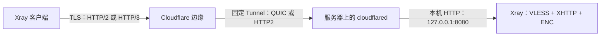

# Argosbx Enhanced

[](https://github.com/mutsuki14/argosbx-enhanced/actions/workflows/test.yml)

基于 [yonggekkk/argosbx](https://github.com/yonggekkk/argosbx) 的增强版，使用 Xray、Sing-box 和 cloudflared 部署代理服务，重点支持 **VLESS + XHTTP + 固定 Argo + TLS + VLESS Encryption（ENC）**。

在基础链路上，可配置 **HTTP/3、QUIC 隧道、XMUX、上下行分离和 FinalMask TLS 分片**。提供 Linux 安装脚本、网页命令生成器和可自行构建的 Node 容器。

> **本项目的所有 Argo 入口只支持固定隧道。** 必须同时提供固定域名和 Tunnel Token；缺失时停止部署，不创建或恢复 `trycloudflare.com` 随机隧道。VMess / VLESS WebSocket 的 Argo 入口同样遵守这一规则。

[快速部署](#快速部署) · [客户端导入](#客户端导入) · [增强组合](#增强组合) · [参数参考](#参数参考) · [Docker 部署](#docker-部署) · [常见问题](#常见问题)

## 功能与适用入口

| 入口 | 用途 | XHTTP 增强组合 |
| --- | --- | --- |
| [argosbx.sh](argosbx.sh) | Linux 主机安装、重配、更新和管理 | 支持 |
| [index.html](index.html) | 在网页中选择参数，生成部署命令 | 支持，包含参数冲突检查 |
| [Node 容器](container/nodejs) | 在容器中运行服务并提供配置下载 | 支持，需从本仓库构建 |
| [SAP 旧版流程](SAP.md) | 保留的上游批量部署方式 | 使用上游镜像，不包含本项目增强组合 |

主脚本还保留原有协议入口，可按需与增强节点一起部署：

| 参数 | 协议 |
| --- | --- |
| `vxpt` | VLESS XHTTP ENC；配合 `argo=vxpt` 启用本文的固定隧道方案 |
| `vlpt` / `xhpt` | VLESS TCP REALITY / VLESS XHTTP REALITY ENC |
| `vwpt` / `vmpt` | VLESS WebSocket ENC / VMess WebSocket |
| `xupt` / `xcpt` | VLESS XHTTP TLS H3 / H2 与 H3 |
| `hypt` / `tupt` | Hysteria2 / TUIC |
| `anpt` / `arpt` | AnyTLS / AnyTLS REALITY |
| `sspt` / `sopt` / `nvpt` | Shadowsocks 2022 / SOCKS5 / NaiveProxy |

这些参数指定各自的监听端口。本文的 `xhttp_*` 增强参数用于 **`vxpt` + `argo=vxpt`**；其他协议的选项、WARP 出站等可通过网页生成器配置。

## 链路结构



- **TLS** 保护客户端至 Cloudflare 的连接，证书由该 HTTPS 入口提供。
- **固定 Tunnel** 连接 Cloudflare 与服务器上的 cloudflared，使用独立的传输协议。
- **VLESS ENC** 提供客户端至 Xray 的端到端加密，TLS 在 Cloudflare 终止不会移除这一层。
- Xray 的增强入站仅监听 `127.0.0.1`，回源使用 HTTP；这个本机端口不需要配置 TLS 证书，也不需要向公网开放。

客户端使用 H3 与 cloudflared 使用 QUIC 是两个独立设置。设置其中一个，不会自动改变另一个。

## 快速部署

### 1. 准备环境

- 一台 Linux `x86_64` 或 `aarch64/arm64` 主机，能够下载 GitHub 上的脚本和内核。
- Bash、curl，以及用于配置生成的 Python 3。root 安装会尝试通过系统包管理器补齐 Python 3；非 root 环境请预先安装依赖。
- 一个可以配置 Cloudflare Tunnel 公开主机名的域名。
- 支持 XHTTP 和 VLESS ENC 的 Xray 客户端；使用 FinalMask 时还需要对应的内核支持。本项目以 **Xray v26.11.9** 验证这些功能。

新安装的 Xray 固定使用官方 **v26.11.9**，下载时验证 SHA-256。脚本不是面向 macOS 或 Windows 主机的原生安装器。

### 2. 配置固定隧道

在 Cloudflare 创建一个通过 Token 运行的**固定 Cloudflare Tunnel**，取得 Tunnel Token，并添加公开主机名：

| 配置项 | 示例 |
| --- | --- |
| 公开主机名 | `up.example.com` |
| 服务类型 | `HTTP` |
| 服务地址 | `127.0.0.1:8080` |

域名必须实际路由到这个隧道，并具有有效的 Cloudflare 边缘证书。cloudflared 与 Xray 需要运行在同一主机或同一网络命名空间中。

`agn` 只填写域名，不带 `https://`、端口或路径；`agk` 只填写 **Token 本身**，不要粘贴整条 cloudflared 安装命令。

### 3. 运行安装命令

替换以下域名和 Token，在 Linux 主机的 Bash 中执行：

```bash
vxpt=8080 argo=vxpt agn=up.example.com agk='YOUR_TUNNEL_TOKEN' \
  bash <(curl -fLsS https://raw.githubusercontent.com/mutsuki14/argosbx-enhanced/main/argosbx.sh)
```

`vxpt=8080` 必须与隧道服务地址中的端口一致。首次安装自动生成 UUID、VLESS ENC 密钥和随机 XHTTP 路径。默认使用客户端 **H2**、隧道 **QUIC**、`packet-up` 模式，并启用 XMUX 默认参数。

安装完成后运行 `agsbx list` 查看节点。若当前终端尚未识别 `agsbx`，重新连接终端，或执行：

```bash
bash "$HOME/bin/agsbx" list
```

连接器启动只代表进程已启动。请检查 Cloudflare 中的隧道状态，再导入客户端实际测试连接。

## 客户端导入

| 文件 | 内容与使用方式 |
| --- | --- |
| `~/agsbx/xhttp-client.json` | 完整 Xray 客户端配置，推荐导入方式；包含 `127.0.0.1:10808` SOCKS 入口 |
| `~/agsbx/xhttp-uri.txt` | VLESS 分享链接，需要客户端支持 XHTTP、ENC 及 URI 中的 `extra` |
| `~/agsbx/jh.txt` | 普通聚合订阅；可完整表达的增强节点链接会加入其中 |
| `~/agsbx/xhttp-options.json` | 保存高级参数和随机路径，供后续重配及重新导出使用 |

运行 `agsbx list` 可重新导出配置。文件包含节点凭据，应作为私有配置保存。

**只要任一方向启用 FinalMask，就必须使用完整 JSON。** 此时 `xhttp-uri.txt` 留空，避免生成缺少分片设置的链接。支持普通 VLESS 链接，不代表支持这些高级字段。

Clash / Mihomo / Sing-box 的原有订阅继续服务于兼容的其他协议；本项目不会把增强 Xray JSON 自动转换为这些客户端的等价节点。使用支持自定义 Xray JSON 的客户端，并确认其内核版本。

## 增强组合

以下命令用于首次部署，域名和 Token 均需替换。**修改现有安装时，在完整命令末尾添加 `rep`，并带上所有需要保留的协议参数**，详见[管理与更新](#管理与更新)。

### HTTP/3 + QUIC 隧道

```bash
xhttp_alpn=h3 agproto=quic \
  vxpt=8080 argo=vxpt agn=up.example.com agk='YOUR_TUNNEL_TOKEN' \
  bash <(curl -fLsS https://raw.githubusercontent.com/mutsuki14/argosbx-enhanced/main/argosbx.sh)
```

客户端至边缘使用 H3，cloudflared 至 Cloudflare 使用 QUIC。前者需要边缘支持 HTTP/3 和客户端网络允许相应 UDP；后者需要服务器能够连接 Tunnel 的 UDP 7844 端口。

如果 UDP 不通，可将客户端改为 `xhttp_alpn=h2`、隧道改为 `agproto=http2`。`agproto=auto` 允许 cloudflared 自动选择及回退；显式选择 `quic` 时脚本不会擅自改为 HTTP2。

### XMUX 连接复用调优

```bash
xhttp_xmux='{"maxConcurrency":"8-16","hMaxRequestTimes":"600-900","hMaxReusableSecs":"1800-3000"}' \
  vxpt=8080 argo=vxpt agn=up.example.com agk='YOUR_TUNNEL_TOKEN' \
  bash <(curl -fLsS https://raw.githubusercontent.com/mutsuki14/argosbx-enhanced/main/argosbx.sh)
```

默认 XMUX 参数如下；提供部分字段时，其余字段补齐为默认值：

```json
{
  "maxConcurrency": "16-32",
  "maxConnections": 0,
  "cMaxReuseTimes": 0,
  "hMaxRequestTimes": "600-900",
  "hMaxReusableSecs": "1800-3000",
  "hKeepAlivePeriod": 0
}
```

`maxConcurrency` 与 `maxConnections` 不能同时非零。只提供 `maxConnections` 时，生成器会将 `maxConcurrency` 置为 `0`。使用 XHTTP 自身的 XMUX 即可，不要再叠加客户端通用 `mux.cool`。

### 上行 Argo，下行直连或另一 CDN

```bash
xhttp_download_address=down.example.com \
  vxpt=8080 argo=vxpt agn=up.example.com agk='YOUR_TUNNEL_TOKEN' \
  bash <(curl -fLsS https://raw.githubusercontent.com/mutsuki14/argosbx-enhanced/main/argosbx.sh)
```

上行经 `up.example.com` 的固定隧道，下行经 `down.example.com`。生成器会写入独立的 `downloadSettings`，包含下行地址、TLS、Host、ALPN 和 XMUX；上下行保持同一路径。

**两个入口必须最终到达同一个 Xray 进程的同一个 XHTTP 入站。** 在另一台服务器运行相同 UUID 的节点，或将请求分散到不同 Xray 副本，都不能替代这个要求。

下行域名需要有效证书，并反向代理到同一 `127.0.0.1:8080`。例如同机 Caddy 的配置：

```caddyfile
down.example.com {
    reverse_proxy 127.0.0.1:8080 {
        flush_interval -1
    }
}
```

请自行准备该域名的解析、证书和访问端口。整条 XHTTP 路径需要原样透传、允许流式响应，并避开缓存、登录验证或验证码。脚本只生成下行客户端设置，不会自动部署第二条线路。

下行连接 IP 时，另外指定证书域名，例如 `xhttp_download_servername=down.example.com`；连接地址、HTTP Host 与证书名称可分别设置，证书校验始终开启。

### FinalMask TLS 分片

```bash
xhttp_alpn=h2 xhttp_finalmask=tls-fragment \
  vxpt=8080 argo=vxpt agn=up.example.com agk='YOUR_TUNNEL_TOKEN' \
  bash <(curl -fLsS https://raw.githubusercontent.com/mutsuki14/argosbx-enhanced/main/argosbx.sh)
```

本项目的 FinalMask 支持范围是 **TCP 上的 TLS ClientHello 分片**，使用 Xray 的 `streamSettings.finalmask`。它作用于客户端连接，不给本机 HTTP 回源添加伪装层，也不允许任意填写与服务不匹配的 SNI 域名。

同一方向的 H3 与 `tls-fragment` 不能叠加。上下行分离时，可分别设置为上行 H3、下行 H2 + FinalMask。启用分片后使用 `xhttp-client.json` 导入。

这些选项可以在兼容条件下组合，但不会保证特定网络的速度提升或抗识别效果。

## 参数参考

以下为首次部署的默认值；重配时，省略的 `xhttp_*` 选项保留已保存的值。

| 参数 | 默认值 | 说明 |
| --- | --- | --- |
| `vxpt` | 未设置时不启用 | XHTTP 本机端口；固定隧道建议明确指定，如 `8080` |
| `argo` | 不启用 | 本方案使用 `vxpt`；也支持 `vwpt`、`vmpt`，须同时设置相应端口变量 |
| `agn` / `agk` | 无 | 固定隧道域名 / Tunnel Token，启用 Argo 时必填 |
| `agproto` | `quic` | 隧道协议：`quic`、`http2` 或 `auto` |
| `uuid` | 自动生成 | 自定义节点 UUID |
| `xhttp_mode` | `packet-up` | 本版固定 HTTP 回源只接受此模式 |
| `xhttp_alpn` | `h2` | 客户端至边缘：`h2` 或 `h3` |
| `xhttp_address` | `agn` | 客户端连接的域名或优选 IP；不改变上行 Host / SNI |
| `xhttp_path` | 随机生成并保存 | 以 `/` 开头，只含字母、数字、`/`、`_`、`-`，总长 2–201 字符 |
| `xhttp_xmux` | 上述 JSON | XMUX 配置对象 |
| `xhttp_finalmask` | `off` | `off` 或 `tls-fragment`；分片要求 H2 |
| `xhttp_download_address` | 空，不分离 | 下行连接域名或 IP |
| `xhttp_download_port` | `443` | 下行 TLS 端口 |
| `xhttp_download_servername` | 下行域名 | 下行证书名称；连接 IP 时必填 |
| `xhttp_download_host` | 下行证书名称 | 下行 HTTP Host |
| `xhttp_download_alpn` | `h2` | 下行 `h2` 或 `h3` |
| `xhttp_download_finalmask` | `off` | 下行独立分片选项：`off` 或 `tls-fragment` |

下行参数需要与 `xhttp_download_address` 一起使用。更多配置说明见 [XHTTP 与固定 Argo 文档](docs/xhttp-argo.md)。

## 管理与更新

| 命令 | 作用 |
| --- | --- |
| `agsbx list` | 查看节点并重新导出客户端配置 |
| `agsbx res` | 重启服务 |
| `agsbx upx` | 更新 Xray；当前组件目标版本为 v26.11.9 |
| `agsbx ups` | 更新 Sing-box |
| `agsbx upa` | 更新 cloudflared，继续使用已保存的固定隧道 |
| `agsbx del` | 卸载服务和配置 |

更新脚本或修改部署参数，重新执行本仓库的完整安装命令并追加 `rep`。例如，将仅部署了增强 XHTTP 的安装改回默认 H2、关闭分片与上下行分离：

```bash
xhttp_alpn=h2 xhttp_finalmask=off xhttp_download_address='' \
  vxpt=8080 argo=vxpt agn=up.example.com agk='YOUR_TUNNEL_TOKEN' \
  bash <(curl -fLsS https://raw.githubusercontent.com/mutsuki14/argosbx-enhanced/main/argosbx.sh) rep
```

`rep` 会重建协议配置，**原有其他协议的端口变量也必须一并带上**。省略高级选项不会将其恢复默认：用 `xhttp_finalmask=off` 关闭上行分片；用 `xhttp_download_address=''` 清除已保存的下行分离设置，并从命令中移除其他下行参数。

已有 Xray 文件不会因重新配置而自动替换；从旧版本迁移时运行 `agsbx upx`。从上游随机隧道迁移时，先创建固定隧道，再使用新域名和 Token 重配。

## Docker 部署

从本仓库根目录构建。**上游 `ygkkk/argosbx` 镜像不包含这里的增强功能。**

```bash
git clone https://github.com/mutsuki14/argosbx-enhanced.git
cd argosbx-enhanced
docker build -f container/nodejs/Dockerfile -t argosbx-enhanced .
```

首次部署生成一个 UUID，再启动容器；替换域名和 Token：

```bash
ARGOSBX_UUID=$(docker run --rm --entrypoint node argosbx-enhanced \
  -p 'require("node:crypto").randomUUID()')

docker run -d --name argosbx-enhanced --restart unless-stopped \
  -e uuid="$ARGOSBX_UUID" \
  -e vxpt=8080 -e argo=vxpt \
  -e agn=up.example.com -e agk='YOUR_TUNNEL_TOKEN' \
  -p 127.0.0.1:3000:3000 \
  -v argosbx-data:/root/agsbx \
  argosbx-enhanced
```

cloudflared 与 Xray 在同一容器内运行。Cloudflare 公开主机名的服务地址仍是 **`http://127.0.0.1:8080`**，不使用网页服务的 `3000` 端口，也无需映射 `8080` 到宿主机。

通过 `-e xhttp_alpn=h3` 等方式传入高级参数。重建容器时保留 UUID、数据卷及原有环境变量；配置卷挂载在 `/root/agsbx`。

查看日志并取出客户端配置：

```bash
docker logs --tail 100 argosbx-enhanced
docker cp argosbx-enhanced:/root/agsbx/xhttp-client.json ./xhttp-client.json
```

Node 服务还提供 `/<UUID>` 普通订阅与 `/<UUID>/xhttp.json` 完整配置下载。上述示例只将网页端口绑定到宿主机本地，可通过 `http://127.0.0.1:3000/<UUID>/xhttp.json` 访问；路径和响应含凭据，请勿公开分享。

## 网页命令生成器

下载仓库后，在仓库根目录运行：

```bash
python3 -m http.server 8000 --bind 127.0.0.1
```

打开 [本地命令生成器](http://127.0.0.1:8000/)，选择协议、填写固定隧道信息和高级参数，再复制命令到目标 Linux 主机执行。生成器会检查域名 / Token 缺失、H3 与分片冲突等问题；它本身不会部署服务。

## 常见问题

**为什么不支持随机隧道？**

本项目按固定域名与 Token 管理隧道生命周期，并针对这条链路生成 XHTTP 配置。部署、重启、更新都不会退回随机隧道。

**为什么不能选择 `auto`、`stream-up` 或 `stream-one`？**

默认回源是 HTTP/1.1。本地真实传输测试发现 `stream-up` 无法在这条默认链路完成传输，因此本方案限定为 `packet-up`。支持流式上行需要另外设计 HTTP/2 回源；本版本未提供。

**隧道显示在线，但客户端仍无法连接？**

核对公开主机名是否指向正确的 `127.0.0.1:<vxpt>`，域名证书是否有效，以及客户端是否完整保留 ENC、路径和高级字段。使用 systemd 时可通过 `journalctl -u argo -n 100 --no-pager` 查看日志；后台启动方式和 Node 容器的 Tunnel 日志位于 `~/agsbx/argo.log`。

**启用分片后为什么分享链接为空？**

普通 URI 无法完整表达顶层 FinalMask。本项目主动停止导出不完整的 URI，请使用完整 Xray JSON。

**上下行分离后下载失败？**

先确认下行域名、证书及反向代理可用，再检查两条路径是否进入同一个 Xray 进程、同一个入站。下行入口不能缓存、改写路径或插入验证页面。

## 验证范围与项目结构

[自动测试](.github/workflows/test.yml)覆盖参数校验、固定隧道启动、凭据缺失、Token 文件权限、配置导出和生成器命令转义；使用真实 Xray 校验配置，并进行 H2、H3、FinalMask 和上下行分离的本地加密双向传输测试，同时构建 Node 容器。

这些检查保持 TLS 证书校验开启，**不等同于真实 Cloudflare 隧道、目标运营商网络或吞吐性能的验证**。部署后仍需使用自己的域名和客户端完成连接测试。

| 路径 | 职责 |
| --- | --- |
| [argosbx.sh](argosbx.sh) | 主机安装和管理 |
| [lib/argo.sh](lib/argo.sh) | 固定隧道校验、凭据保存和启动 |
| [lib/xhttp_config.py](lib/xhttp_config.py) | XHTTP 参数处理、配置生成、导出和 Xray 下载校验 |
| [index.html](index.html) / [generator-enhanced.js](generator-enhanced.js) | 网页命令生成器 |
| [container/nodejs](container/nodejs) | 增强容器入口 |
| [tests](tests) | 配置与传输回归测试 |
| [docs/xhttp-argo.md](docs/xhttp-argo.md) | 固定隧道和组合参数的详细说明 |

## 致谢与许可

本项目基于 [yonggekkk/argosbx](https://github.com/yonggekkk/argosbx) 修改，感谢原作者及社区贡献者；核心组件来自 [XTLS/Xray-core](https://github.com/XTLS/Xray-core)、[SagerNet/sing-box](https://github.com/SagerNet/sing-box) 和 [cloudflare/cloudflared](https://github.com/cloudflare/cloudflared)。

本仓库沿用 [GNU GPL v3 许可证](LICENSE)。各内核与依赖遵循其各自许可证。
